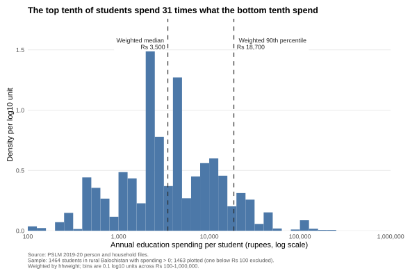
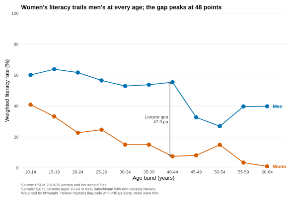
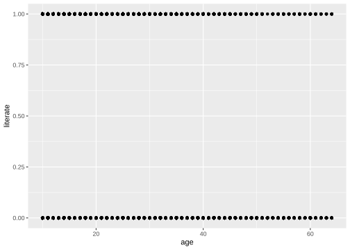
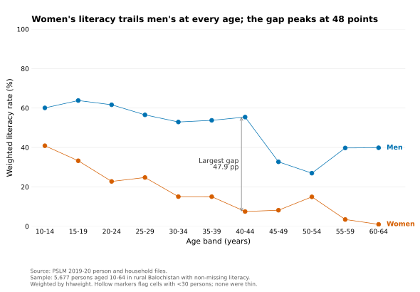

# ECO346-A1-FA24-BED-046

**Course:** ECO346 Data Visualization Techniques for Economists  
**Assignment:** 1, Fall 2026  
**Registration no.:** FA24-BED-046  
**Section:** B  
**Variant:** 6, Balochistan rural (`prov_code == 4`, `urban_rural == 1`)

This repository contains the R and Python code, SVG figures, band table, and slides for Assignment 1. The two required figures are Question 2 (`figures/distribution.svg`) and Question 3 (`figures/literacy.svg`). The untouched default of Question 4 is `figures/default.svg`; the Python replication for Question 5 is `figures/literacy_python.svg`.

## Reproduce everything offline

Requirements:

- R with `ggplot2`, `svglite`, and `scales`.
- Python with `pandas`, `numpy`, and `matplotlib`.
- `ragg` is needed only for optional PNG previews; it is not part of the deliverables.

```bash
git clone https://github.com/malliyan89/ECO346-A1-FA24-BED-046.git
cd ECO346-A1-FA24-BED-046
Rscript scripts/run_all.R
```

`run_all.R` reads only the two local CSV files in `data/`, regenerates every SVG in `figures/`, writes the band tables and key numbers to `outputs/`, and runs the R-Python comparison. No internet connection is used.

The required structure is `README.md`, `data/`, `scripts/`, `figures/`, and `slides/`. The extra `outputs/` folder is an audit trail: it holds the two band tables and the printed numbers used in this README.

## Repository map

```text
ECO346-A1-FA24-BED-046/
├── README.md
├── data/
│   ├── pslm_person_subset.csv
│   └── pslm_hh_subset.csv
├── scripts/
│   ├── 00_common.R              shared data, weighting, and plot helpers
│   ├── 01_default.R             Question 4 default scatterplot
│   ├── 02_distribution.R        Question 2 histogram
│   ├── 03_literacy.R            Question 3 redesign and band table
│   ├── 04_literacy_python.py    Question 5 Python replication
│   ├── 05_compare_tables.R      Question 5 R-Python check
│   └── run_all.R                runs 01-05 in order
├── figures/
│   ├── default.svg
│   ├── distribution.svg
│   ├── literacy.svg
│   └── literacy_python.svg
├── outputs/
│   ├── band_table_r.csv
│   ├── band_table_python.csv
│   ├── q2_numbers.txt
│   ├── q3_numbers.txt
│   ├── q5_numbers.txt
│   └── table_comparison.txt
└── slides/
    └── FA24-BED-046.pptx
```

## Question 1: repository and commit history

The default figure of Question 4 was committed before the Question 3 redesign. The history is incremental:

| Commit | What changed |
|---|---|
| `8a95869` | Add PSLM data subsets and repository skeleton |
| `e14a83b` | Add shared data preparation and weighted-statistic helpers |
| `8831a06` | Add untouched default literacy scatterplot (Question 4) |
| `0c7a73d` | Add weighted log histogram of education spending (Question 2) |
| `bba2d06` | Redesign literacy figure with weighted conditional means (Question 3) |
| `e1a1483` | Add Python replication and R-Python table check (Question 5) |

The final commits add this README and the slides.

## Data and sample

The person file has no household weight, province, or area. I attached `hhweight`, `prov_code`, and `urban_rural` from the household file by `hhid`, then kept variant 6: `prov_code == 4` and `urban_rural == 1`.

- Variant sample: 8,463 persons in 1,505 households.
- Literacy sample: persons aged 10-64 with non-missing `literate`; 5,677 persons (3,145 men, 2,532 women).
- Students: persons with `ed_total > 0`; 1,464 persons. The figure plots the 1,463 within Rs 100-1,000,000; one student at Rs 30 is excluded.
- Every statistic is weighted by `hhweight`.
- Age bands are five years wide, from 10-14 to 60-64, and are plotted at midpoints 12, 17, ..., 62. A band for one sex is thin when it has fewer than 30 unweighted observations. No cell is thin; the smallest cell has 59 persons.

The weighted mean is `sum(w * x) / sum(w)`. The weighted p-th quantile is the smallest `x` at which the cumulative weight share reaches or exceeds `p`; this follows the assignment definition, not `stats::quantile()`.

## Question 2: the distribution



**Numbers.** Students: 1,464. Plotted: 1,463. Excluded: 1 (Rs 30, outside Rs 100-1,000,000). Weighted median: Rs 3,500. Unweighted median: Rs 3,000. Weighted 10th percentile: Rs 600. Weighted 90th percentile: Rs 18,700. Ratio p90/p10: 31.17.

**Answer (77 words).** The distribution is strongly right-skewed: the weighted 90th percentile (Rs 18,700) is 31.17 times the 10th (Rs 600). The weighted median is Rs 3,500, Rs 500 above the unweighted median. Just under half the weight (48.8%) lies below Rs 3,000, although half the students do; the Rs 3,000-3,500 bin pushes cumulative weight past 50%. Weights are nearly uncorrelated with spending (r = -0.01), so the medians are close and the gap is small beside the 31-fold spread.

## Question 3: literacy by age and sex



**Numbers.** Women aged 15-19: 33.3%; men aged 15-19: 63.8%. Women aged 55-59: 3.5%; men aged 55-59: 39.7%. Largest gap: ages 40-44, 47.9 percentage points (men 55.4%, women 7.5%).

**Answer (90 words).** Female literacy is 40.9% at ages 10-14, 33.3% at 15-19 and 3.5% at 55-59; male literacy is 63.8% at 15-19 and 39.7% at 55-59. The gender gap peaks at 47.9 percentage points at ages 40-44. This is consistent with cohort effects in human capital: older women had far less schooling, and female schooling remains lower. It may also reflect survival and migration selection. The cross-section cannot separate age from cohort effects, so it does not show whether women lose literacy as they age or older cohorts were simply less literate.

**Full band table.** Weighted literacy rates, with unweighted cell counts.

| Age band | Men (n) | Men (%) | Women (n) | Women (%) | Gap (pp) |
|---|---:|---:|---:|---:|---:|
| 10-14 | 663 | 60.1 | 428 | 40.9 | 19.2 |
| 15-19 | 477 | 63.8 | 293 | 33.3 | 30.6 |
| 20-24 | 358 | 61.7 | 307 | 22.8 | 38.9 |
| 25-29 | 355 | 56.5 | 347 | 24.8 | 31.8 |
| 30-34 | 297 | 52.9 | 309 | 15.1 | 37.9 |
| 35-39 | 266 | 53.8 | 252 | 15.0 | 38.7 |
| 40-44 | 227 | 55.4 | 198 | 7.5 | 47.9 |
| 45-49 | 181 | 32.7 | 149 | 8.2 | 24.6 |
| 50-54 | 133 | 27.0 | 111 | 14.9 | 12.0 |
| 55-59 | 95 | 39.7 | 79 | 3.5 | 36.3 |
| 60-64 | 93 | 39.8 | 59 | 1.0 | 38.9 |

## Question 4: the makeover

**Untouched default:** `ggplot(literacy, aes(x = age, y = literate)) + geom_point()`, with R's defaults and nothing added.



**Redesign:** the Question 3 figure above.

**Answer (126 words).** The default plots 5,677 individual 0/1 outcomes, so points overplot and the conditional mean is invisible. The redesign replaces them with weighted band-by-sex means: position on a common scale is the strongest perceptual channel (Ch. 1), and conditional means answer the question directly. Colour now encodes sex, and each series is labelled at its end, so preattentive grouping replaces a legend lookup (Ch. 2). Hollow markers flag thin cells and a direct annotation marks the largest gap, encoding reliability and guiding attention (Ch. 4). Removing the grey panel and adding a finding title and source caption raises the data-ink ratio (Ch. 3). What the default shows that the redesign hides is the full individual-level spread: the raw 0/1 values, within-band heterogeneity and the exact age distribution.

## Question 5: second language, Python



**Numbers.** R: women aged 15-19 are 33.3% literate. Python: women aged 15-19 are 33.3% literate. All 11 bands and cell counts are identical, and every rate agrees to one decimal. Maximum absolute difference before rounding: 0.0000000000.

The two tables are in `outputs/band_table_r.csv` and `outputs/band_table_python.csv`; the check is in `outputs/table_comparison.txt`.

**Answer (63 words).** R and Python agree to one decimal: women aged 15-19 are 33.3% literate in R and 33.3% in Python. The clearest default difference was the vertical axis: matplotlib autoscaled to the observed rates, stopping near 64%, while the R figure is fixed at 0-100. I set the Python axis to 0-100 and matched the x limits, colours, markers, line widths and direct labels.

## Question 6: slides

[slides/FA24-BED-046.pptx](slides/FA24-BED-046.pptx)

Four slides: the variant, the makeover with default and redesign side by side, the key finding, and the second-language/reproducibility check. All figures are embedded as SVG.

## Method notes

- The histogram uses 40 bins of 0.1 log10 units from 2.0 to 6.0. Density is the weighted share of students in a bin divided by 0.1, so it is density per log10 unit and integrates to 1.
- The weighted median and 90th percentile in Question 2 use the assignment's cumulative-weight definition. The unweighted median is included only for the comparison requested in the question.
- The Question 3 lines join weighted band means. The figure has no legend: each series is labelled directly at its right end. The largest gap is marked with an arrow and a text label. Hollow markers would indicate a cell with fewer than 30 persons; no cell met that rule.
- The Python script uses the same CSV files, the same variant filter, the same age bands, and the same weighted-mean formula. It writes its own band table and SVG, so the comparison is independent of the R figure.

## Software used

R 4.6.1; ggplot2 4.0.3; svglite 2.2.2; scales 1.4.0. Python 3.14.8; pandas 3.1.0; numpy 2.5.4; matplotlib 3.11.2. PowerPoint was used only to assemble the slides from the SVG files.

## Google Form fields

For submission, use these values:

- **F1:** Name: [your name]; FA24-BED-046; Section B; Variant 6.
- **F2:** https://github.com/malliyan89/ECO346-A1-FA24-BED-046
- **F3:** Q2: 1,464 students; weighted median Rs 3,500; unweighted median Rs 3,000; p10 Rs 600; p90 Rs 18,700; ratio 31.17; 1 excluded. Q3: women 15-19 33.3%, men 15-19 63.8%; women 55-59 3.5%, men 55-59 39.7%; largest gap 40-44 at 47.9 pp. Q5: R 33.3%, Python 33.3%.
- **F4:** The four answers above, each within its word limit.
- **F5:** Python.
